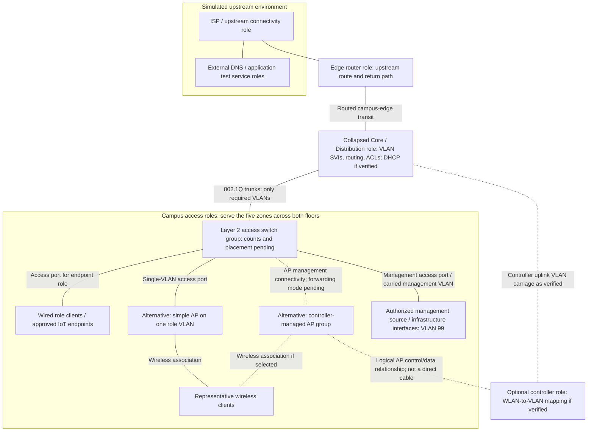

# Architecture Decision and Cisco Packet Tracer Simulation Feasibility Audit

**Project:** Campus WLAN Optimization Using Access Point Placement and Network Segmentation  
**Context:** Five-member Computer Networks capstone, SRM Institute of Science and Technology  
**Audit date:** 3 November 2026  
**Decision status:** Recommendations awaiting project-lead approval. This document does not authorize topology implementation or amend the existing requirements.  
**Work boundary:** Read-only environment/source inspection and this new Markdown document only. No installation, application execution, device configuration, final addressing, topology construction or experimental measurements were performed.

## 1. Executive Summary

**Recommend Option B: collapsed core/distribution with Layer 2 access switching and a separate routed Internet edge.** This is a proposed change from the current initial full three-tier requirement, not an approved replacement. It retains hierarchical access and aggregation, VLAN segmentation, centralized routing and policy while reducing unnecessary separation for a hypothetical compact two-floor campus. Exact equipment quantities and models remain undecided until demand and simulator capabilities are approved.

The local audit found macOS 27.0.1 on an Apple M4/arm64 computer. No installed Packet Tracer simulator was found in the searched locations or running process list. A downloaded `CiscoPacketTracer_901_macOS_64bit.dmg` was found on the Desktop. Read-only mounting revealed an **installer**, not an installed simulator. Its executable contains both arm64 and x86_64 slices, and its signature verifies. These observations support installer platform compatibility; they do not prove the packaged simulator's architecture, application version, launch success or device palette.

**Current readiness verdict: not verified ready for simulation.** Local runtime/device capabilities are **NEEDS MANUAL VERIFICATION**. Cisco documentation provides a credible basis for planning VLANs, multilayer routing and selected WLAN functions, but does not establish that the downloaded package is installed or that every feature operates in this build.

Primary evidence should be functional addressing, association, routing and access-policy tests. Sampled model coverage and association distribution are defensible proxies when defined carefully. Real campus RF coverage, realistic WLAN Mbps, production capacity, seamless roaming and accurate QoS performance must not be claimed from this audit or assumed from Packet Tracer.

## 2. Existing Requirements Review

### 2.1 Sources actually inspected

| Artifact | Current content and implication |
| --- | --- |
| [scenario-requirements.md](scenario-requirements.md) | Read in full. Confirms the hypothetical floors/zones, VLAN planning proposal, initial three-tier requirement and comparable baseline/optimized experiments. Detailed policies, quantities and test methods remain proposed or open. |
| [architecture.md](architecture.md) | Names Core, Distribution and Access, core routing, distribution connectivity, availability and redundancy principles. No actual topology or evidence establishes those features. |
| [vlan-plan.md](vlan-plan.md) | Uses the older category mapping; proposes core-based inter-VLAN routing and ACLs, with AP/trunk details unfinished. |
| [ip-addressing.md](ip-addressing.md) | Repeats the older VLAN mapping. Network range, masks, host counts, subnets and gateways remain unspecified. |
| [wireless-plan.md](wireless-plan.md) | Empty, zero bytes. No AP, channel or SSID design to validate. |
| [testing.md](testing.md) | Lists coverage, performance, security and load tests; execution method remains incomplete. Listed external tools are not verified as part of a Packet Tracer workflow. |
| [results.md](results.md) and existing CSVs | Narrative claims success without supporting runs. CSV summaries have no established experimental provenance; none are accepted as measured results here. |
| Repository PPT and `.pkt` files | All zero-byte placeholders. No slide content or saved topology can be inspected. |

The exact reference `Campus WLAN Optimization.pptx` and report template `Computer Networks Course Case study project report.docx` were not found in the repository, surrounding `Desktop/CN` tree or available attachment tree. The differently named repository PPT is empty. Presentation architecture, actual slide requirements and report formatting therefore remain **NEEDS MANUAL VERIFICATION**. No unavailable reference content has been inferred.

### 2.2 Confirmed planning basis

- Hypothetical campus, entirely simulation-based; no equipment purchase or physical deployment required.
- Ground floor: classrooms, computer laboratory, common area/lobby. First floor: library, faculty/administration offices. These are five functional zones, not prescribed room or AP counts.
- Initial architecture: Core, Distribution, Access. Option B requires explicit approval against SCP-06, FR-03 and CON-03 in the requirements document. BL-06, proposing the same three-tier role structure across experiments, is itself a proposed control.
- Current VLAN proposal: 10 Students; 20 Faculty; 30 Administration; 40 Guests; 50 IoT; 99 Network Management.
- Separate baseline/optimized files and comparable representative clients, workloads and test conditions. No numerical improvement is predetermined.

### 2.3 Preserved conflicts

| VLAN | Existing VLAN/addressing documents | Current planning proposal |
| --- | --- | --- |
| 1 | Default | Default/native handling undecided |
| 10 | Faculty | Students |
| 20 | Students | Faculty |
| 30 | Guest | Administration |
| 40 | Administration | Guests |
| 50 | Absent | IoT |
| 99 | Absent | Network Management |

Use the current proposal for conceptual planning; retain the discrepancy until a separately authorized reconciliation. Do not copy legacy labels into future configuration. No existing document is changed by this decision record.

## 3. Packet Tracer Environment Audit

### 3.1 Observed host and software state

| Item | Evidence | Finding / confidence boundary |
| --- | --- | --- |
| Operating system | `sw_vers` | macOS **27.0.1**, build **26A434**, directly observed. |
| CPU and execution architecture | `uname -m`; CPU/machine/arm64 `sysctl` values | Apple M4; arm64 host; arm64 supported. Current inspection process is not translated (`sysctl.proc_translated = 0`). |
| Installed memory | `sysctl hw.memsize` | 17,179,869,184 bytes, or 16 GiB installed. Free RAM was not established. |
| Disk headroom | Read-only filesystem capacity inspection | Approximately 12.4 GB free during inspection; transient headroom, not a performance guarantee. |
| Installed simulator search | Spotlight name/display-name search; bounded directory traversal | No matching installed app found in `/Applications`, `~/Applications`, `/opt`, `/usr/local` or `~/Downloads` to the searched depth. Spotlight found the Desktop image and project folder. Unindexed/nonstandard locations cannot be excluded. |
| Running simulator | Process executable-name inspection | No matching Packet Tracer process observed. |
| Downloaded media | File metadata and disk-image metadata | `/Users/dhruvmishra/Desktop/CiscoPacketTracer_901_macOS_64bit.dmg`, 477,460,616 bytes; readable compressed disk image. |
| Image contents | Mounted read-only, without browsing or auto-opening | Volume `Cisco Packet Tracer 9.0.1` contains `PacketTracer901_installer.app`. No directly accessible installed simulator or device catalog was established. |
| Installer architecture | `file`; `lipo -archs` | Installer Mach-O is universal: **x86_64 and arm64**. This is evidence about the installer executable only. |
| Installer OS metadata | Mach-O build load commands | Installer minimum macOS is **12.0**. Host exceeds this stated minimum; actual execution remains untested. |
| Installer signature | `codesign` display and verification | Signature identifies Cisco Systems, Inc, team `9X38D433RE`; verification passed; a stapled notarization ticket is reported. No online notarization assessment or execution was performed. |
| Version interpretation | Volume/app/executable names and installer `Info.plist` | Names identify a **9.0.1 / Build858-labelled installer**. Its bundle version is **4.11.0**; this is installer-bundle metadata, not an established simulator release or evidence of Packet Tracer application version 4.11.0. |
| Actual installed Packet Tracer version | No installed simulator bundle found | **NEEDS MANUAL VERIFICATION**. A download filename is not an installed application version. |
| Rosetta evidence | Receipt query for `com.apple.pkg.RosettaUpdateAuto` | No receipt found. This alone does not establish all translation availability; no simulator need for Rosetta is inferred. |
| Launch success and runtime compatibility | No installed simulator available for safe inspection | **NEEDS MANUAL VERIFICATION**. The installer was not executed; no install, sign-in, preference change or application launch was attempted. |

The image was detached after inspection; no audit-created disk image remains mounted. No installer payload was extracted or installed. Commands inspected metadata and signatures rather than invoking the installer. This distinguishes installer feasibility from simulator readiness.

Cisco's online requirements list macOS 12 or newer, free memory/storage and display prerequisites. The observed OS meets that documented minimum, but installed RAM is not free RAM and a newer OS number does not prove application certification or launch success. Display suitability and actual workload headroom remain unverified. [Cisco system requirements](https://tutorials.ptnetacad.net/help/default/systemRequirements.htm)

### 3.2 Device availability: documentary examples versus local verification

**No model below is confirmed available locally or selected for the project.** These are explicitly sourced examples to guide a later palette inspection, not invented inventory or final hardware recommendations.

| Category | Cisco-documented examples | Local availability / required verification |
| --- | --- | --- |
| Router | 2911 appears in Cisco's Packet Tracer router catalog. | **NEEDS MANUAL VERIFICATION**: palette presence, ports, routing, ACL, DHCP and any required NAT behavior. [Router catalog](https://tutorials.ptnetacad.net/help/default/devicesAndModules_routers.htm) |
| Layer 2 switch | 2960-24TT appears in the switch catalog. | **NEEDS MANUAL VERIFICATION**: VLANs, 802.1Q trunks, port roles and relevant management controls. |
| Multilayer switch | 3560-24PS and 3650-24PS appear in the catalog; Cisco's FAQ identifies multilayer switch models. | **NEEDS MANUAL VERIFICATION**: SVI routing, routed uplink, ACL directions and local DHCP support. [Switch catalog](https://tutorials.ptnetacad.net/help/default/devicesAndModules_switches.htm), [FAQ](https://tutorials.ptnetacad.net/help/default/faqTroubleShoot.htm) |
| AP | Generic access-point configuration; LAP-PT and 3702i are described in Cisco help. | **NEEDS MANUAL VERIFICATION**: actual palette labels, radio/client compatibility, channel controls and VLAN transport. [Other-device configuration](https://tutorials.ptnetacad.net/help/default/config_others.htm) |
| WLAN controller | WLC-PT and Cisco 2504 WLC are described in help. | **NEEDS MANUAL VERIFICATION**: WLAN/VLAN mapping, AP registration and actual forwarding mode. [WLC configuration](https://tutorials.ptnetacad.net/help/default/config_WLCs.htm) |
| Wireless security | Cisco AP documentation describes WPA2-PSK and configurable encryption; documented options vary by device. | **NEEDS MANUAL VERIFICATION** for the selected AP/client pair. WPA3 is not established by the reviewed evidence. |

**Environment conclusion:** suitable host characteristics for further evaluation, but **no verified usable Packet Tracer installation**. Do not describe this computer as simulation-ready until an installed application's About/version information, launch and device palette have been checked. Installation or software changes require a separate authorized task and were not performed here.

## 4. Architecture Alternatives

All alternatives retain the current VLAN planning roles and the same security objectives. Architectural simplicity does not by itself prove higher WLAN performance.

### Option A: full three-tier

Concept: simulated upstream → edge router → Core → Distribution → Access → wired clients/APs. Distribution aggregates access and is a natural policy/gateway location; the core provides backbone transit. Exact gateway placement is a design choice, not a consequence of layer names.

It most directly preserves the existing three separate layers. It introduces additional switching roles, links and routing boundaries without presently approved demand or resilience requirements justifying that separation. It remains appropriate if the academic rubric requires three physical tiers or the scenario expands. Redundancy must be designed and tested separately; three tiers alone do not provide it.

### Option B: collapsed core/distribution

Concept: simulated upstream → edge router → central multilayer aggregation → Layer 2 access → wired clients/APs. The central switching role combines Core and Distribution; VLAN gateways and inter-VLAN policy reside there. The router handles the upstream edge rather than carrying every inter-VLAN exchange.

This is a hierarchical two-tier switching design, not a full three-tier topology with different labels. It concentrates configuration and fault impact but makes the proposed campus easier to build, debug and explain. Additional distribution/core separation can be discussed as future growth, not silently claimed present.

### Option C: router-on-a-stick

Concept: simulated upstream → router with VLAN subinterfaces → tagged Layer 2 trunk → switches/APs/clients. The router supplies VLAN gateways and inter-VLAN ACL enforcement. Traffic between VLANs traverses the router trunk, so its capacity and router processing can become shared constraints.

It is useful for a small VLAN teaching demonstrator or a fallback when suitable multilayer switching is unavailable. Combining edge and inter-VLAN routing makes the shared router more central to both policy and troubleshooting. It does not physically preserve separate Core/Distribution tiers and needs approval if adopted.

## 5. Architecture Comparison

The ratings are qualitative engineering judgments for this hypothetical scope, not measured simulator performance or procurement estimates.

| Criterion | A: Full three-tier | B: Collapsed core/distribution | C: Router-on-a-stick |
| --- | --- | --- | --- |
| Complexity | Highest: separate layer boundaries and more paths to document. | Moderate: central routing/policy plus access. | Low/moderate: fewer roles, but subinterface/trunk dependencies. |
| Device requirements | Separate core, distribution and access roles plus edge and WLAN devices. Quantities T. | Multilayer aggregation, access, edge and WLAN categories. Quantities T. | VLAN-capable router, Layer 2 switching, edge service path and WLAN categories. Quantities T. |
| Scalability | Best structural separation for multiple aggregation blocks; presently unneeded. | Appropriate starting structure for compact scope; aggregation resources eventually constrain growth. | Limited by shared router/trunk and policy concentration. |
| VLAN support | Access/trunk transport; gateways at selected Layer 3 boundary. | Access/trunk transport; central SVIs proposed. | Trunks carry VLANs to router subinterfaces. |
| Inter-VLAN routing | Typically distribution in this alternative; must reconcile older core-routing wording. | Central multilayer SVIs. | Router subinterfaces over the shared trunk. |
| Security | Policy boundaries can be distributed; more placement consistency to manage. | Central inter-VLAN ACL boundary; device management still needs separate restrictions. | Router ACL boundary; same-VLAN limitations remain. |
| Ease of simulation | Most setup and verification work; no automatic scientific benefit. | Clear paths and fewer layer boundaries, subject to verified switch capabilities. | Strong teaching fallback if subinterfaces and trunking work. |
| Two-floor suitability | Potentially excessive without rubric/resilience need. | Best fit for current compact scenario, pending demand. | Feasible for a small demonstration; less attractive as the primary campus model. |
| Academic explanation | Shows all tiers clearly; may consume time on hierarchy rather than WLAN experiments. | Explains why hierarchy can be combined while preserving functions. | Clearly teaches VLAN routing but adds a shared routed bottleneck to interpret. |
| Requirements alignment | Closest to the initial physical hierarchy. | Deliberate deviation requiring lead approval. | Larger deviation requiring lead approval. |

Cisco describes both collapsed-core and separate-core campus structures. Its guidance supports selecting the hierarchy according to aggregation, growth and failure-domain needs; it does not establish that this project's unapproved demand requires three tiers. [Cisco campus LAN/WLAN design guide](https://www.cisco.com/c/en/us/td/docs/solutions/CVD/Campus/cisco-campus-lan-wlan-design-guide.html)

## 6. Recommended Architecture

**Recommendation: Option B, awaiting project-lead approval and local capability verification.**

| Design area | Proposed choice | Boundary |
| --- | --- | --- |
| Logical hierarchy | Collapsed Core/Distribution aggregation with a distinct Access role. | Explicit change to the current initial three-tier requirement. |
| Edge | Separate router connecting to a simulated ISP/upstream service environment. | Not evidence of real Internet connectivity; no ISP speed assumed. |
| Switching | Layer 2 access, explicit VLAN membership and required tagged uplinks. | Exact models, ports, quantities and floor assignment remain open. |
| Gateways and routing | VLAN SVIs on the central multilayer role; a routed edge transit. | Requires verified SVI, routed-port and ACL support. |
| Route exchange | Directly connected VLANs; default route toward edge and explicit return routes toward campus. | Static routing proposed for simplicity; no route or address assigned here. Dynamic routing optional only if justified. |
| DHCP | Prefer DHCP pools on the central multilayer role if its simulator implementation supports them. | Placement is conditional; otherwise reconsider a dedicated service endpoint and relay, with approved service VLAN/placement. |
| DNS / external test service | Simulated upstream service endpoint(s) for the initial external-service use case. | Actual domains, addresses and quantities remain open. |
| WLAN | Prefer a verified controller/lightweight-AP path when multi-SSID/VLAN requirements justify it. | Conditional on support and workload; simple AP fallback has a narrower role described in Section 9. |
| Management | Infrastructure management interfaces in VLAN 99; authorized management sources only. | VLAN 99 is not automatically a shared-services or guest-access VLAN. |
| ACL boundary | Source-VLAN ingress at the routed SVI boundary, with explicit service/reply exceptions. | Final directions and rule design need testing; no ACL configuration generated. |

This preserves the objectives of organized access, aggregation, segmentation, centralized routing and controlled communication. It **does not** preserve three physically separate switching tiers, prove high availability, implement a firewall appliance or validate every statement in the old results narrative. Core-routing intent is served by the combined role; the separate Distribution role is merged explicitly.

Presentation consistency cannot be confirmed because the deck is unavailable/empty. Following approval, a later documentation task must explain the collapsed hierarchy consistently in the architecture, report and PPT. If three separate tiers are mandatory, retain Option A and adapt the gateway/policy placement explicitly rather than relabelling Option B as three-tier.

For causal clarity, prefer the same approved structural architecture in baseline and optimized networks. Compare placement, channels and segmentation without simultaneously changing every routed path. Any architecture-change experiment must be labelled separately. This control is also a proposal requiring approval.

## 7. Logical Network Diagram

The diagram expresses **logical roles and conditional forwarding**, not equipment quantities, final floor assignments, cable ports or AP positions. The external block is a simulated network. Dotted connections show optional controller integration; the two WLAN paths are alternatives for capability evaluation, not a prescribed combined deployment.

The supported central/local WLAN switching mode determines where client traffic enters its VLAN. AP management connectivity does not automatically mean all client VLANs are trunked to the AP. Controller management, data VLANs, relay behavior and device control traffic must be traced end to end during a future capability check. No wireless subnet is hidden behind an assumed home-router NAT boundary.

## 8. Switching and Routing Strategy

### 8.1 Placement of functions

| Function | Proposed location / link behavior | Approval and capability condition |
| --- | --- | --- |
| Default gateways | Central multilayer SVIs for VLANs 10, 20, 30, 40, 50 and 99. | Role mapping confirmed; gateway placement proposed. Exact addresses/subnets not assigned. |
| Inter-VLAN routing | Central multilayer role. | Verify routing, SVI state and required VLAN presence. |
| DHCP | Central multilayer pools where verified. | Local service would not require a relay to itself. If a remote server is selected, relay and explicit ACL exceptions are required. |
| Inter-switch transport | 802.1Q trunks between access and aggregation carrying only necessary approved VLANs. | Native/default VLAN treatment, spanning-tree design and VLAN lists pending. |
| Wired endpoints | Untagged access ports in the endpoint role VLAN. | Role determined by purpose, not automatically by floor. |
| Simple AP | Single-role access VLAN if the verified AP bridges an untagged SSID. | Do not configure a trunk and assume the AP implements tagging or multiple WLANs. |
| Controller/AP path | AP management connectivity and controller VLAN uplink according to verified forwarding mode. | Controller centrally switched versus AP locally switched behavior changes tagging requirements. |
| Campus-edge link | Routed transit, separate from user VLAN trunking. | Transit subnet and exact interfaces deferred. |
| Upstream reachability | Default route toward edge; reciprocal campus routes on edge/upstream as needed. | NAT only if required by the approved external model, not automatically mandatory in a closed routed simulation. |
| ACLs | Proposed source-SVI ingress filtering for inter-VLAN traffic, plus edge controls and infrastructure management restrictions. | Rule direction, reply flows and device support require verification. |

A switch management SVI does not make a Layer 2 access switch an inter-VLAN router. A trunk does not itself provide routing. VLAN membership alone is not a complete authorization policy. Avoid an additional unapproved services VLAN: if central-switch DHCP is unavailable, select and approve service placement explicitly, including any change to the VLAN proposal.

### 8.2 Security consequences of forwarding

Traffic between hosts in one VLAN usually stays at Layer 2 and bypasses routed SVI ACLs. Thus guest-to-guest blocking, same-VLAN management restrictions and intra-IoT isolation need separately supported controls or an expressly limited claim. User-to-infrastructure administration should be restricted at management services as well as routed boundaries.

Stateless ACLs do not track sessions. Define permitted reply traffic carefully; an entry in the policy matrix describes initiation intent, not an automatically generated stateful rule. DHCP discovery/relay, DNS queries/responses, application replies and permitted diagnostic traffic must be considered. Do not use a blanket reply exception that also enables forbidden initiation. Some initiation-only semantics may require narrowing the test or an additional verified control.

## 9. Wireless Simulation Feasibility

### 9.1 Classification and evidence scope

- **DIRECTLY SUPPORTED:** The scoped function is explicitly documented or demonstrated; always state the evidence scope.
- **PARTIALLY SUPPORTED:** A simplified subset is available/documented; enterprise behavior is not established.
- **ANALYTICAL MODEL REQUIRED:** A quantitative claim needs an explicit model beyond a GUI setting or connectivity demonstration.
- **NOT SUPPORTED:** Positive evidence establishes absence for a specific device/build; absence of documentation alone is insufficient.
- **NEEDS MANUAL VERIFICATION:** The local build/device/UI behavior cannot currently be inspected or demonstrated.

The documentary column below refers to Cisco help, **not local runtime verification**. Every listed local UI feature is unverified because no installed simulator was found. No unsupported feature is invented, and WPA3 is not declared absent merely because the reviewed pages do not list it.

| Feature | Documentary or analytical assessment | Classification for the available local environment | Required later verification / boundary |
| --- | --- | --- | --- |
| SSID configuration | DIRECTLY SUPPORTED in documented AP settings. | NEEDS MANUAL VERIFICATION | Record selected AP/client controls and successful association. |
| Multiple SSIDs | PARTIALLY SUPPORTED at the documented controller/WLAN level; not established for every AP. | NEEDS MANUAL VERIFICATION | Verify multiple role WLANs on the selected arrangement; do not assume a generic AP exposes them. |
| SSID-to-VLAN mapping | DIRECTLY SUPPORTED in WLC documentation, conditional on switching mode. | NEEDS MANUAL VERIFICATION | Verify client address, VLAN path, DHCP and policy for each approved WLAN. |
| AP channel configuration | DIRECTLY SUPPORTED in generic AP help; controlled AP behavior may differ. | NEEDS MANUAL VERIFICATION | Inspect available channels and whether the controller or AP owns the setting. |
| 2.4 GHz | DIRECTLY SUPPORTED for documented tri-band home-router radios; selected campus AP support not established. | NEEDS MANUAL VERIFICATION | Check AP/client radio compatibility and band-specific controls. |
| 5 GHz | DIRECTLY SUPPORTED for the documented home-router device; not proof for an enterprise AP model. | NEEDS MANUAL VERIFICATION | Verify selected AP and client band options before including a dual-band experiment. |
| WPA2 | DIRECTLY SUPPORTED in documented AP authentication options. | NEEDS MANUAL VERIFICATION | Verify compatible authentication/encryption on both sides; propose WPA2 with AES where supported. |
| WPA3 | No positive support or absence established by reviewed documentation. | NEEDS MANUAL VERIFICATION | Inspect options in the actual build; keep outside committed scope until proven. |
| Wireless client association | PARTIALLY SUPPORTED: modelled association can demonstrate connectivity, not production radio behavior. | NEEDS MANUAL VERIFICATION | Capture actual AP/SSID association and a traced successful application flow. |
| AP load distribution | PARTIALLY SUPPORTED as observing represented-client association counts; automatic balancing is unverified. | NEEDS MANUAL VERIFICATION | Compare association counts under equal workloads; counts are not airtime or automatic load balancing. |
| WLC integration | DIRECTLY SUPPORTED at the documented AP/controller configuration level. | NEEDS MANUAL VERIFICATION | Verify AP registration, client forwarding and role VLANs on the chosen combination. |
| Roaming behavior | Seamless roaming and transition timing are not established by reviewed evidence. | NEEDS MANUAL VERIFICATION | Reassociation can be observed only after a defined test; do not promise enterprise fast roaming. |
| Coverage display / range | PARTIALLY SUPPORTED by Physical Workspace range/distance representation. | NEEDS MANUAL VERIFICATION | Verify scale/preferences and fixed test points; do not infer real building RF performance. |
| Quantitative coverage prediction | ANALYTICAL MODEL REQUIRED for area calculations beyond defined sampled points. | ANALYTICAL MODEL REQUIRED | Approve dimensions, geometry and propagation assumptions; results remain hypothetical estimates. |
| Interference representation | PARTIALLY SUPPORTED qualitatively; Cisco FAQ discusses association effects, not calibrated RF measurements. | NEEDS MANUAL VERIFICATION | Record observed behavior without claiming realistic interference power or loss rates. |
| Quantitative interference reduction | ANALYTICAL MODEL REQUIRED for a defensible simplified reuse/overlap analysis. | ANALYTICAL MODEL REQUIRED | Define adjacency/reuse assumptions. No measured RF improvement is established. |

Evidence: [Cisco AP/LAP configuration](https://tutorials.ptnetacad.net/help/default/config_others.htm), [WLC configuration](https://tutorials.ptnetacad.net/help/default/config_WLCs.htm), [tri-band home-router bands](https://tutorials.ptnetacad.net/help/default/config_HomeRouter.htm), [range model](https://tutorials.ptnetacad.net/help/default/workspace_physical_distanceMeasurements.htm), [model limitations FAQ](https://tutorials.ptnetacad.net/help/default/faqTroubleShoot.htm). Device-specific examples do not confer those features on other devices.

### 9.2 Proposed WLAN selection path

Prefer a verified controller/AP arrangement if the approved requirement is multiple role SSIDs with VLAN mapping on shared AP infrastructure. Controller documentation is not proof of automatic RF management, client balancing or roaming guarantees. Keep controller management restricted and permit only specifically required AP/controller service flows.

If that arrangement is unavailable, evaluate simple AP bridging on a single access VLAN as a narrower educational fallback. Multiple role-specific APs may then be necessary; this changes resource counts and the channel experiment and requires approval. It is not equivalent to one multi-SSID AP. Using routed home devices without deliberate AP/bridge behavior can introduce hidden DHCP/NAT and defeat the planned VLAN model.

Do not pick AP counts, positions, band/channel sets or SSID counts until demand, spatial assumptions and the actual palette are known. A management VLAN does not need a management SSID. Any manual association choices must be reported as operator-controlled assignments rather than evidence of automatic balancing.

## 10. Security Policy Proposal

**All permissions and denials below are proposed and require project-lead approval.** The existing category/VLAN mapping is the planning basis; it does not approve a communication policy.

The matrix describes **new session/flow initiation**. `D` = deny by default; `E` = explicit approved endpoint/service only; `M` = authorized maintenance source and protocol only; `L2` = same-VLAN traffic, separately governed. An `E` or `M` is not unrestricted access to a whole subnet. Replies require explicit compatible rules and testing.

| Initiating source | Students 10 | Faculty 20 | Administration 30 | Guests 40 | IoT 50 | Management 99 | Simulated external services |
| --- | --- | --- | --- | --- | --- | --- | --- |
| Students 10 | L2 | D | D | D | D | D | E: approved learning/external services |
| Faculty 20 | D | L2 | D | D | E only for an approved teaching/controller use | D | E: approved teaching/external services |
| Administration 30 | D | D | L2 | D | E only for an approved administrative use | D | E: approved administrative/external services |
| Guests 40 | D | D | D | L2; client isolation unresolved | D | D | E: approved external services |
| IoT 50 | D | D | D | D | L2; controller/service scope unresolved | D | D unless a specific required endpoint is approved |
| Authorized management sources in 99 | M only where endpoint maintenance is required | M only where required | M only where required | D | M only where required | M for approved infrastructure; same-VLAN controls still needed | E only for defined management needs |

**Shared service exceptions:** students, faculty and administration may reach explicitly approved learning/shared application endpoints, even when a service is hosted in a category otherwise marked `D`. Guests receive only their approved bootstrap/external services. Exceptions are narrow destination/protocol permissions that must be recorded before ACL design; the matrix does not silently place a shared server in any VLAN.

| Policy detail | Proposed treatment and verification |
| --- | --- |
| DHCP | Eligible clients may obtain leases from the selected service. For IPv4 DHCP, account for UDP client/server ports 68/67 and relay behavior where used; do not open general access to the DHCP device. |
| DNS | Permit UDP/TCP destination port 53 only to approved resolver endpoints, plus required responses. Resolver location remains a proposal. |
| Protected administration | Other user categories receive no default access to administrative endpoints; document any explicitly approved application exceptions. |
| Student/faculty separation | Deny unsolicited direct cross-role access by default while allowing approved shared services. This is a proposed security posture, not a supplied institutional policy. |
| Management | Permit administration of devices only from named authorized sources using approved protocols. Administration users are not automatically network administrators. Address-based ACLs do not prove user identity. |
| Same-VLAN restrictions | Guest-client isolation, protected services within the administration VLAN and management-source restrictions cannot rely solely on routed ACLs. Verify supported local controls or narrow the claim. |
| IoT | Approve device purpose, controller destination and protocols before permitting user/controller traffic. Same-VLAN IoT flows may bypass the gateway. |
| Replies and diagnostics | Define response paths and allowed diagnostic traffic; test application protocols as well as ICMP. Do not claim stateful inspection from an ACL alone. |

No ACL statements or device configurations are generated. Final policy needs source, destination, protocol/port, direction, enforcement point, action and positive/negative test IDs. Baseline policy gaps are recorded separately; performance comparisons use services intentionally permitted in both scenarios.

## 11. KPI Measurement Feasibility

**No KPI was measured in this task.** Every local measurement method below is **NEEDS MANUAL VERIFICATION**. These are proposed collection methods and reporting limits, not experimental results or approved targets. Historical CSV values are not repeated or used as findings.

| KPI | What a verified Packet Tracer workflow could demonstrate | Evidence to collect later | Reliability boundary / separate model or tool |
| --- | --- | --- | --- |
| Latency | ICMP reachability and simulator-reported response/RTT observations, where the selected endpoint supports them. | Named source/destination, ping transcript or screenshot, packet parameters, trial ID and warm-up state; event times for a precisely defined interval if meaningful. | Simulator timings are not real campus latency. Keep RTT distinct from one-way delay. No host-clock or animation-speed timing. External validation only if a real-performance claim is later required. |
| Packet loss | Delivery success for repeated defined tests under fixed conditions. | Sent/replied application-PDU counts, deadline/window, independent runs and failure reasons. Separate ARP/convergence, policy denials and unavailable routes from congestion effects. | This is test delivery/failure, not calibrated RF loss. A failed ping alone does not prove congestion. Analytical assumptions may be needed for a capacity-loss model. |
| Throughput | Supported traffic-generation/protocol behavior and, only if reliable payload/time observations exist, a labelled simulation goodput calculation. | Delivered payload amount, interval, direction, per-client/aggregate scope and raw event records; feasibility check precedes any calculation. | Realistic WLAN Mbps is not established. Link speed, icon count, transfer animation and host elapsed time are insufficient. Use an explicit analytical model or a separately approved performance simulator for quantitative research claims; neither is mandatory deployment. |
| AP load | Which represented clients associate to which AP, and distribution counts under the specified workload. | Client/AP inventory, association details or verified controller client records, activity schedule and per-AP counts. Use traced paths where association displays are ambiguous. | Association count is not airtime, throughput, CPU load or proof of automatic balancing. Demand-weighted load requires a labelled model. |
| Coverage | Range display and success at fixed spatial test points in an approved scale. | Physical view, model scale/preferences, AP settings, test-point positions and qualifying service outcome. | Point success ratio is not floor-area percentage. Area estimates need approved geometry and overlap handling; RF-quality coverage needs a separate validated model or later physical study. |
| Concurrent users | Represented endpoints that are associated, active and successful in a defined simultaneous test. | Separate configured/associated/active/successful counts, common workload and run record. | Does not establish production user capacity. Host slowdown and simulator association limits are not real WLAN saturation. Any extrapolation is analytical. |
| Connection time | A specified interval such as trigger-to-association or DHCP-start-to-lease, if both events are observable on a consistent clock. | Event definitions, trace/timestamps, warm/cold state and independently repeated trials. | Association, DHCP and application readiness differ. Unobservable timing is reported not measurable; do not substitute wall-clock stopwatch timing for protocol timing. |
| Bandwidth utilization | Any verified interface traffic counters/rates or a clearly labelled offered-load/capacity estimate. | Named interface/direction, supported outputs, counter semantics, interval, resets and workload; only calculate if counters actually reflect modelled traffic. | CLI fields may be missing, static or simplified. Cisco's FAQ flags port-statistics limitations. Do not treat configured bandwidth or an unexplained displayed rate as measured utilization. External model/tool needed if counters cannot support the claim. |

Cisco's Simulation Mode documentation explains event-based observation; the FAQ records simplified statistics, wireless scaling and QoS limitations. These justify narrowing claims rather than manufacturing unavailable metrics. [Simulation Mode](https://tutorials.ptnetacad.net/help/default/mode_simulation.htm), [FAQ](https://tutorials.ptnetacad.net/help/default/faqTroubleShoot.htm)

### Experimental controls proposed for approval

Record common role/client identities, workloads, traffic schedules, source/destination services, packet definitions, endpoint positions, upstream resources and test points. Keep AP quantities/capabilities constant for the primary placement comparison unless a separate resource-change experiment is approved. Define cold-start versus steady-state tests, ARP/DHCP/convergence treatment, repetition count and acceptance criteria in advance.

Use paired baseline/optimized runs at each common workload level. Separate policy-correctness tests from performance tests; an ACL intentionally blocking traffic is not packet-loss improvement or degradation. Intermediate variants help distinguish placement/channel changes from VLAN effects; a combined variant cannot isolate each cause.

Retain raw observations, topology/version identity, operator, date, method and evidence paths before computing summaries. Label observations, analytical estimates, targets, unsupported legacy entries and not-measurable metrics separately. No numerical workloads, target thresholds or improvement values are approved here.

## 12. Assumptions and Limitations

| Item | Status and consequence |
| --- | --- |
| Compact two-floor/five-zone hypothetical campus | Confirmed scenario. Dimensions, adjacency, client demand and vertical radio model are still open. |
| Six role VLANs | Confirmed planning proposal; existing legacy documents are inconsistent. No final subnets or addresses assigned. |
| Collapsed hierarchy | Proposed requirements deviation, awaiting lead approval. The existing three-tier requirement remains the recorded initial basis. |
| Multilayer gateways, local DHCP and routed edge | Proposed strategy requiring local feature checks. No device model or capability has been selected as verified. |
| Controller-based WLAN | Conditional proposal, not a verified local capability or mandatory added device count. |
| Simulated external services | Proposed test boundary; not real Internet connectivity or ISP-performance evidence. |
| Security matrix | Proposed policy. Service exceptions, reply handling and same-VLAN limits require explicit review. |
| Downloaded installer | Observed, statically inspectable media. Names and installer metadata do not prove a working simulator installation. |
| Documentation versus installed build | Cisco online help may cover multiple devices/versions and historical limitations. Apply it as scoped documentary evidence, then verify the selected build. |
| Physical RF and production capacity | Outside what this audit establishes. No physical deployment is required; use transparent analytical estimates or narrower claims. |
| Academic reference alignment | Actual PPT/report unavailable; precise alignment cannot be confirmed. |
| Existing work | Preserved. `scenario-requirements.md` was already untracked when Task 3 began; it is not a new Task 3 artifact. |

### Major implementation risks and proposed responses

1. **No verified simulator runtime:** resolve environment/version/palette availability before model selection; do not execute the installer within this planning task.
2. **Wireless/VLAN mismatch:** verify end-to-end role mapping before designing the full AP deployment; simple APs and controller paths have different limits.
3. **Conflicting VLAN documentation:** reconcile in a later authorized change and cross-check every dependent artifact.
4. **Unapproved architectural deviation:** retain Option A if the lead/rubric rejects a collapsed hierarchy; do not present combined roles as three physical tiers.
5. **ACL service or reply breakage:** define explicit exceptions and application-level positive/negative tests; keep management protections separate.
6. **Central failure concentration:** a collapsed aggregation role concentrates impact. No resilience/availability claim without a separately approved redundant design and tests.
7. **Invalid performance inference:** association counts, display ranges and configured rates are not real capacity/coverage/throughput measurements.
8. **Confounded comparison:** changing AP counts, routed architecture, policy and workload together prevents attribution; predeclare controls and intermediate variants.

## 13. Architecture Decision Register

Every new design recommendation below awaits approval; repeated confirmed scenario/VLAN decisions are identified explicitly. No row authorizes implementation.

| Decision | Recommendation | Reason | Approval status |
| --- | --- | --- | --- |
| ADR-01 — Hierarchy | Adopt Option B collapsed Core/Distribution plus Access, with separate edge routing. | Proportionate to compact scope and clearer central policy. | **Awaiting project-lead approval**; changes initial three-tier requirement. |
| ADR-02 — Full-tier fallback | Use Option A if three separate tiers are academically mandatory. | Preserves initial hierarchy literally. | Conditional fallback, not selected. |
| ADR-03 — Routing | Central SVIs, routed edge transit, default/return static routes initially. | Keeps inter-VLAN traffic off the edge router trunk and simplifies reasoning. | Awaiting approval and capability verification. |
| ADR-04 — Switching | Layer 2 access and explicit required-VLAN trunks; role access ports for endpoints. | Separates attachment from routing and makes membership traceable. | Awaiting approval and device verification. |
| ADR-05 — VLAN identity | Retain 10 Students, 20 Faculty, 30 Administration, 40 Guests, 50 IoT, 99 Management. | Current Task 2/3 planning basis. | Planning mapping already supplied; configuration and legacy reconciliation not approved/performed. |
| ADR-06 — Addressing | Defer all subnet ranges, gateways and transit addresses until demand approval. | Prevents unsupported sizing and premature configuration. | Deferred by task restriction. |
| ADR-07 — DHCP | Prefer central-switch pools only after feature verification; otherwise review service endpoint/relay placement. | Avoids adding an unapproved service VLAN or exposing management by default. | Awaiting approval and capability verification. |
| ADR-08 — External service | Use a simulated upstream DNS/application path; NAT only if the selected model requires it. | Satisfies the external-access use case without a live Internet dependency. | Awaiting approval. |
| ADR-09 — WLAN path | Evaluate controller/lightweight APs for shared multi-SSID/VLAN needs; treat simple APs as a scoped fallback. | Avoids assuming enterprise tagging on generic APs. | Awaiting approval and manual verification. |
| ADR-10 — Radio/security | Verify AP/client bands and channels; propose WPA2/AES where supported; leave WPA3 uncommitted. | Ties features to observed controls rather than real-device assumptions. | Awaiting approval and manual verification. |
| ADR-11 — Security | Review Section 10 matrix; enforce approved routed policy at central SVIs and protect management services separately. | Restricts role communication while disclosing same-VLAN/stateless limits. | Awaiting project-lead approval. |
| ADR-12 — Primary experiment | Keep structure, represented clients and shared resources comparable; label resource/architecture changes separately. | Improves interpretability of before/after evidence. | Awaiting approval. |
| ADR-13 — KPIs | Prioritize functional policy, delivery and association evidence; accept RF/performance estimates only with explicit models. | Avoids unsupported production claims. | Awaiting approval and method verification. |
| ADR-14 — Runtime readiness | Record no verified installed simulator; require version/launch/palette review before implementation. | Installer inspection does not establish a usable environment. | Audit finding; environment remediation is a separate authorized task. |
| ADR-15 — Optional scope | Defer QoS, automated balancing, roaming guarantees and redundant hardware until justified and supported. | Prevents unsupported feature commitments. | Awaiting project-lead approval. |

## 14. Unresolved Questions

1. Does the project lead approve Option B as an explicit deviation from the initial three-tier requirement, or does the rubric require Option A?
2. Is Packet Tracer installed in a nonstandard/unindexed location? What exact About/version/build and launch behavior can be verified in an installed simulator?
3. Which router, Layer 2 switch, multilayer switch, AP/client and WLC options actually appear in the team's agreed build, and which required functions work?
4. What represented population, role/zone allocation, wired/wireless mix and simultaneous workload will be approved as simulation assumptions?
5. What illustrative dimensions, spatial scale, inter-floor assumptions and fixed test points should guide placement and coverage proxies?
6. Which roles need wireless SSIDs, which shared services are required, and does that justify a controller or a simpler demonstrator?
7. Can the central multilayer model provide the proposed DHCP functions, or must service placement/relay be redesigned? Where should DNS and application services reside?
8. Which policy exceptions, management sources, same-VLAN restrictions and reply semantics are required and feasible?
9. What baseline deficiencies, controlled differences, independent trial counts and measurable acceptance criteria will be approved before collection?
10. Is a separately labelled analytical performance/RF model wanted, or should quantitative claims be limited to verified simulator observations?
11. When can the actual reference PPT, report template, rubric and deadline be reviewed? Who owns later reconciliation of documentation and unverified legacy CSVs?
12. Which optional features, if any, are mandatory: QoS, traffic distribution, roaming demonstrations or resilience? Which team member will own each binary artifact and evidence review?

## 15. Recommended Next Implementation Task

**First review this architecture recommendation and the simulation constraints. Do not begin topology implementation before that review.**

After approval, the next engineering activity should be **environment readiness and an approved capability checklist**, resolving requirements decisions D-02, D-05 and D-10. Locate an existing simulator or handle installation in a separately authorized task; verify About/build, successful launch and the actual palette. Static compatibility evidence alone is insufficient.

Then, only under a subsequent implementation task, verify the chosen VLAN/gateway/DHCP/ACL and wireless association/mapping path in a small capability exercise before committing to the full campus model. This document contains no configuration or topology for that exercise. Confirm the measurement methods at the same stage so unsupported KPIs can be removed or reframed early.

Approve representative demand, geometry and service/policy details before final equipment counts, AP placement and subnet design. Apply the same reviewed architecture and experimental controls to the baseline and optimized plans, then construct and validate the baseline before controlled optimization. Maintain separate raw evidence and derived results; complete academic conclusions only from defensible findings.

### Technical reference register

Primary technical sources consulted on 3 November 2026; these are genuine Cisco/Networking Academy references, not the missing project PPT/report:

- [Cisco Campus LAN and Wireless LAN Solution Design Guide](https://www.cisco.com/c/en/us/td/docs/solutions/CVD/Campus/cisco-campus-lan-wlan-design-guide.html) — hierarchy and collapsed-core context.
- [Packet Tracer System Requirements](https://tutorials.ptnetacad.net/help/default/systemRequirements.htm) — documented host prerequisites.
- [Devices and Modules: Routers](https://tutorials.ptnetacad.net/help/default/devicesAndModules_routers.htm) and [Switches](https://tutorials.ptnetacad.net/help/default/devicesAndModules_switches.htm) — documented model examples, not local inventory.
- [Configuring Other Devices](https://tutorials.ptnetacad.net/help/default/config_others.htm) — AP/LAP controls; [Wireless LAN Controllers](https://tutorials.ptnetacad.net/help/default/config_WLCs.htm) — WLAN/VLAN and controller settings.
- [Configuring Tri-Band Home Router](https://tutorials.ptnetacad.net/help/default/config_HomeRouter.htm) — scoped documentary evidence of radio-band options, not selected campus AP capability.
- [Physical Workspace Distance Measurements](https://tutorials.ptnetacad.net/help/default/workspace_physical_distanceMeasurements.htm) and [Simulation Mode](https://tutorials.ptnetacad.net/help/default/mode_simulation.htm) — spatial and event-based observation boundaries.
- [Packet Tracer FAQ/Troubleshooting](https://tutorials.ptnetacad.net/help/default/faqTroubleShoot.htm) — simplified IOS, statistics, wireless and QoS limitations; build-specific verification remains necessary.
