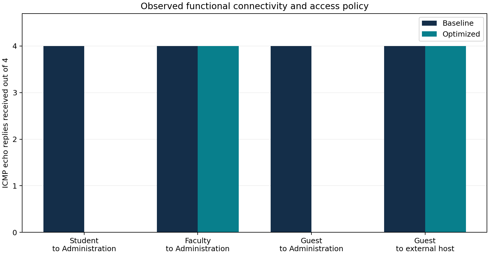

# Verified functional results

Current CSVs are derived from actual completed Packet Tracer transcripts. Legacy unsupported throughput and coverage values were preserved unchanged in [results/historical](../results/historical/README.md) and excluded from conclusions.

| Flow | Baseline replies / 4 | Optimized replies / 4 | Optimized policy |
| --- | --- | --- | --- |
| Wired within VLAN | 4 | 4 | allow |
| Student to Administration | 4 | 0 | deny |
| Faculty to Administration | 4 | 4 | allow |
| Guest to Administration | 4 | 0 | deny |
| Guest to external host | 4 | 4 | allow |
| IoT proxy to Administration | 4 | 0 | deny |
| Wireless Student to wired Student | 4 | 4 | allow |
| Student to management switch | 4 | 0 | deny |
| IoT proxy to external host | 4 | 4 | allow |

All nine baseline probes functioned. All thirteen optimized probes matched expected permission or denial. Two DHCP role pools were actually exercised; six pools are configured. Both standalone wireless clients have verified permitted data forwarding. The historical WLC failure remains unresolved.

The graph shows functional probe reply counts, not throughput, coverage, latency or generic packet-loss improvement. Full evidence and limitations: [report-content.md](../report/report-content.md).
