# Campus WLAN Optimization Using Access Point Placement and Network Segmentation

**Report content and evidence package — 5 November 2026**  
**Institution:** SRM Institute of Science and Technology.  
**Team:** five members; names and register numbers await the team.  
**Environment:** Cisco Packet Tracer 9.0.1.0858 on macOS.  
**Status:** functioning baseline and optimized simulation files with recorded functional evidence. Final institutional formatting awaits the user-supplied report template.

This document supplies the six requested chapters. Figures are actual evidence captures or an explicitly identified results graph. Original capability-test findings remain separate and unchanged. The title expresses the project aim; measured findings establish segmentation and connectivity behavior, not RF optimization performance.

## Chapter 1 — Introduction

### 1.1 Context and problem statement

Campus networks serve different trust groups and should distinguish shared access from restricted departmental and management resources. A flat client network allows communication that may violate those intended boundaries. Wireless planning also needs deliberate placement and channel choices, but a logical simulator does not replace a physical RF survey.

The project models a compact two-floor hypothetical university campus. The ground floor contains Classrooms, Computer laboratory and Common area; the first floor contains Library and Faculty/administration. Students, Faculty, Administration, Guests, IoT and Network Management are distinct roles. A full core–distribution–access hierarchy with a separate edge router is an approved academic requirement. It is retained in both networks to make the baseline comparison clear; no assertion is made that a real campus of this assumed size requires three tiers.

### 1.2 Aim and objectives

The aim is to produce a working simulation comparison that combines role segmentation with a more deliberate AP/channel arrangement. Objectives are to implement the approved six VLANs, verify trunking and routed connectivity, allocate addresses through DHCP, enforce ACL restrictions, demonstrate basic standalone wireless forwarding, and document exactly what the simulator evidence supports.

### 1.3 Scope and representative campus

Eight campus endpoints and one external test host represent traffic roles. Infrastructure comprises one edge router, one core switch, one distribution switch, two access switches and two APs. Together these make 16 devices in each topology. This is a manageable functional sample, not a real population estimate or saturation-load study. Ground and first-floor labels group zones on a logical canvas; they do not encode actual building dimensions.

## Chapter 2 — Literature Survey

### 2.1 Hierarchical campus architecture

Cisco's campus design guide [1] describes layered campus roles that separate endpoint attachment, aggregation/policy and backbone transport. The project applies these concepts through distinct access switches, a distribution switch owning gateways and ACLs, and a routed core. Production guidance provides architectural context; actual Packet Tracer command support and behavior require independent verification.

### 2.2 WLAN placement and channel planning

Cisco's site-survey guidance [2] supports validating a WLAN against its real environment and application needs. Accordingly, this simulation does not turn AP icons into measured coverage claims. Cisco RF-channel guidance [3] informs the use of distinct channel choices. The implemented channel 1/6 plan is a qualitative improvement in organization over 1/1; no measured interference reduction is claimed.

### 2.3 Addressing and access boundaries

RFC 2131 [4] supplies the DHCP protocol context, including obtaining client addressing through servers and relay agents. RFC 1918 [5] defines private address ranges used in guest restrictions. The project tests actual lease output and forwarding policies rather than inferring success from configuration syntax.

### 2.4 Engineering gap and contribution

These sources do not prove that a particular simulated AP, switch or controller behaves like production hardware. The project's contribution is a reproducible, evidence-linked functional implementation in the installed simulator. The historical WLC forwarding failure illustrates why association and configured VLAN names are insufficient evidence. This is a focused technical-source survey, not a claim of exhaustive peer-reviewed research or a novel RF algorithm.

## Chapter 3 — Methodology

### 3.1 Evidence-first audit and preservation

The starting project contained zero-byte campus .pkt files and an unusable zero-byte original presentation. Historical CSV values lacked supporting measurement evidence. Before implementation, project and capability-lab files were hashed; legacy CSVs were copied unchanged into results/historical. The historical reports, screenshots and uploaded references were retained. Final hashing identified one exception: task-7/tests/H02_wireless_forwarding_diagnostic.pkt changed at 19:26:37 during the initial GUI session; an original byte copy was not recovered. The other 851 of 852 historical files match their initial hashes. The difference is disclosed in the final audit and must not be described as complete byte preservation. Previously verified wired VLAN 10 control remains PASS at 4/4 in both directions including reopen. Historical controller wireless remains FAIL with repeated 0/4; traffic observed in VLAN 99 did not establish the intended VLAN 10 path.

### 3.2 Controlled baseline and optimized pair

Both topologies use the same device models, eight campus endpoint identities, two APs, external host and routed tier structure. Baseline clients share VLAN 1 and 10.10.1.0/24, with no departmental ACLs. Its two APs are centrally clustered on channel 1. The optimized copy assigns role VLANs, applies routing policies and separates AP logical positions, with channels 1 and 6. No baseline link or endpoint was deliberately broken. The experiment changes several design aspects together; it cannot isolate an AP-placement effect from segmentation.

### 3.3 Implementation sequence

1. Place the minimal topology and validate native device interfaces.
2. Configure the functioning shared baseline, DHCP and standalone WLANs.
3. Run baseline probes and save/reopen the native file.
4. Configure optimized access VLANs, 802.1Q trunks, distribution SVIs, routed core, DHCP relay and ACLs.
5. Read back VLAN membership, trunk forwarding state, routes, leases and ACL counters.
6. Run allowed and denied probes with positive controls; preserve initial and repeated outputs.
7. Save/reopen the optimized .pkt, renew the two DHCP clients and retest five critical paths.
8. Derive CSVs and figures from completed transcripts, then assemble the presentation and this report package.

### 3.4 Test interpretation

A permitted test passes when a completed steady-state four-echo probe receives four replies. An initial ARP/convergence trial may receive fewer; original output is retained and a bounded repeat is recorded. A restricted flow passes its policy check when no echo reply is received, the source has a working permitted control and ACL readback/counters support the restriction. Denied probes may report Destination host unreachable from the gateway. These are intentional policy outcomes, not a measured packet-loss rate. Every CSV row links to its actual raw transcript.

## Chapter 4 — Implementation

### 4.1 Device selection and actual roles

The 2911 provides the external-facing routed link and IOS DHCP server. The 3650-24PS supplies routed core transport; its simulated power supply was installed to make the device operational. The 3560-24PS owns all VLAN gateways, helper addresses and inter-role ACLs. Two 2960 switches provide Layer 2 access and trunks. Two standalone AP-PT units bridge one SSID each onto their respective switch access VLAN. Six campus PC-PT devices, two Laptop-PT clients with WPC300N wireless adapters and an external PC complete the topology. The candidate WLC path was not adopted because its prior forwarding failure remained unresolved.

### 4.2 Three-tier forwarding path

```text
External PC6 — 2911 edge / DHCP — 3650 core — 3560 distribution
                                                    |          |
                                               2960 Ground  2960 First
                                               PCs / APs    PCs
```

The distribution–access connections are 802.1Q trunks. Core–distribution and edge–core are routed /30 links. Inter-VLAN packets therefore route at the distribution layer; packets to the external host traverse distribution, core and edge. This is a single-path academic topology without hardware or gateway redundancy.

| Local interface | Remote device / interface | Optimized use |
| --- | --- | --- |
| 2911 Gi0/0 | 3650 Gi1/0/1 | 10.255.0.1 / .2, /30 |
| 3650 Gi1/0/2 | 3560 Fa0/1 | 10.255.0.5 / .6, /30 |
| 3560 Fa0/2 | Ground 2960 Fa0/1 | 802.1Q: 10,20,30,40,50,99; native 99 |
| 3560 Fa0/3 | First 2960 Fa0/1 | 802.1Q: 10,20,30,40,50,99; native 99 |
| 2911 Gi0/1 | PC6 FastEthernet0 | 203.0.113.1 / .10, /24 |
| Ground Fa0/2 | PC0 | Access VLAN 10 |
| Ground Fa0/3 | PC1 | Access VLAN 10 |
| Ground Fa0/4 | PC2 | Access VLAN 50 |
| Ground Fa0/5 | AP0 Port0 | Access VLAN 10 |
| Ground Fa0/6 | AP1 Port0 | Access VLAN 40 |
| First Fa0/2 | PC3 | Access VLAN 20 |
| First Fa0/3 | PC4 | Access VLAN 30 |
| First Fa0/4 | PC5 | Access VLAN 99 |

Both APs retain wired attachment to the Ground access switch, including AP1 placed logically near the Library. This represents centralized wireless cabling rather than a second-floor local AP uplink. A proposed AP rewire was cancelled when the application offered a delete-device action; the saved topology and port map above record the retained attachment.

### 4.3 VLANs and endpoint addressing

All addresses below are simulation allocations. The baseline campus gateway is 10.10.1.1/24 at distribution VLAN 1; the optimized VLAN gateways are:

| VLAN | Role | Simulation subnet | Distribution gateway |
| --- | --- | --- | --- |
| 10 | Students | 10.10.10.0/24 | 10.10.10.1 |
| 20 | Faculty | 10.10.20.0/24 | 10.10.20.1 |
| 30 | Administration | 10.10.30.0/24 | 10.10.30.1 |
| 40 | Guests | 10.10.40.0/24 | 10.10.40.1 |
| 50 | IoT | 10.10.50.0/24 | 10.10.50.1 |
| 99 | Network Management | 10.10.99.0/24 | 10.10.99.1 |

| Endpoint | Role / logical zone | Baseline IP | Optimized IP | Addressing |
| --- | --- | --- | --- | --- |
| PC0 | Students, Classrooms | 10.10.1.101 | 10.10.10.10 | Static |
| PC1 | Students, Computer laboratory | 10.10.1.21 | 10.10.10.21 | DHCP, observed |
| PC2 | IoT policy proxy, Computer laboratory | 10.10.1.150 | 10.10.50.10 | Static; PC-PT |
| PC3 | Faculty, Library | 10.10.1.22 | 10.10.20.21 | DHCP, observed |
| PC4 | Administration, Faculty/admin | 10.10.1.130 | 10.10.30.10 | Static |
| PC5 | Management, Faculty/admin | 10.10.1.199 | 10.10.99.10 | Static |
| Laptop0 | Students, Common area | 10.10.1.110 | 10.10.10.20 | Static; wireless |
| Laptop1 | Guests, Library | 10.10.1.140 | 10.10.40.20 | Static; wireless |
| PC6 | External test host | 203.0.113.10 | 203.0.113.10 | Static; simulated external network |

Campus endpoint masks are /24; their optimized gateway is the .1 address of their role subnet. The external PC uses /24 and gateway 203.0.113.1. Ground and First access-switch management SVIs are 10.10.99.11 and 10.10.99.12. Baseline Ground management is 10.10.1.11. The core holds a campus summary route toward distribution and a default toward edge. Distribution defaults to core; edge routes the campus 10.10.0.0/16 summary toward core. These broad summaries are sufficient for this isolated exercise and are not an enterprise route-filtering design.

### 4.4 Representative applied CLI

The following excerpts reflect commands applied and accepted on the actual models. Full per-device command sequences are in [submission-evidence/configurations](../submission-evidence/configurations/); the configuration readback and command transcripts are in [logs](../submission-evidence/logs/). These sequences are supporting source files, not exported full running configurations.

```ios
! Access switch, one Student endpoint
vlan 10
 name STUDENTS
interface fastEthernet0/2
 switchport mode access
 switchport access vlan 10
 spanning-tree portfast
!
! Distribution uplink to Ground
interface fastEthernet0/2
 switchport trunk encapsulation dot1q
 switchport mode trunk
 switchport trunk native vlan 99
 switchport trunk allowed vlan 10,20,30,40,50,99
!
! Distribution gateway and relay
ip routing
interface vlan 10
 ip address 10.10.10.1 255.255.255.0
 ip helper-address 10.255.0.1
 ip access-group STUDENTS_IN in
 no shutdown
!
ip access-list extended STUDENTS_IN
 permit udp any eq bootpc any eq bootps
 deny ip any 10.10.30.0 0.0.0.255
 deny ip any 10.10.99.0 0.0.0.255
 deny ip any 10.255.0.0 0.0.255.255
 permit ip any any
```

DHCP is hosted at edge address 10.255.0.1 and reached through the core. Six pools use their corresponding /24 and distribution .1 default gateway; addresses .1 through .20 are excluded. Actual reopened leases were PC1 10.10.10.21 and PC3 10.10.20.21. Router bindings confirm MAC addresses 0030.A3C2.9DB0 and 000B.BE26.9266 respectively. DNS service was not deployed; there is no claimed DNS success.

### 4.5 Access-control policy

Student ingress denies Administration, Management and infrastructure-transit destinations, then permits other IP. Faculty and Administration ingress deny Management and transit destinations but permit other IP. Guest ingress permits DHCP and ICMP to its own gateway, denies RFC 1918 destinations, then permits public destinations. IoT ingress permits DHCP, ICMP to its own gateway and traffic to the designated external test host, then denies other IP. ACL DHCP exceptions precede restrictions. An edge ingress ACL blocks external access to Management and infrastructure transit addresses. Management has no distribution ingress ACL.

These ACLs are stateless. For example, a management-originated external probe's return traffic to VLAN 99 would also meet the edge restriction; unrestricted management Internet access is neither provided nor claimed. The design is not a stateful firewall and does not prevent Layer 2 attacks, address spoofing or traffic between peers within one role VLAN. Faculty-to-Administration reachability represents a permitted resource endpoint, not a tested application service.

### 4.6 Standalone WLAN configuration

AP0 advertises STUDENT_WIFI with WPA2-PSK/AES and uplinks Ground Fa0/5. AP1 advertises GUEST_WIFI and uplinks Ground Fa0/6. The test key CampusLab2026 is a disposable demonstration credential. Both APs use channel 1 in baseline; optimized AP0 uses 1 and AP1 uses 6. The optimized Student and Guest bridge VLANs are 10 and 40 respectively. The wireless clients use matching SSID/security and static role addresses. Actual forwarding is demonstrated by Laptop0 reaching PC0 and Laptop1 reaching the external host; association alone was not treated as success.

### 4.7 Genuine implementation figures

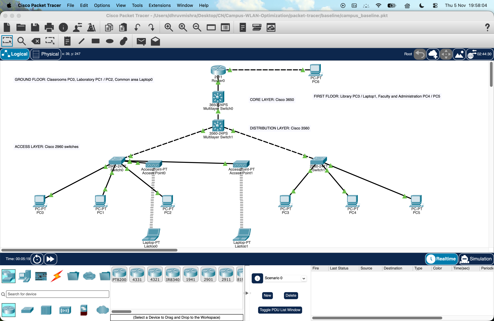

**Figure 1.** Functioning baseline: shared client VLAN 1, clustered APs, same three network tiers.

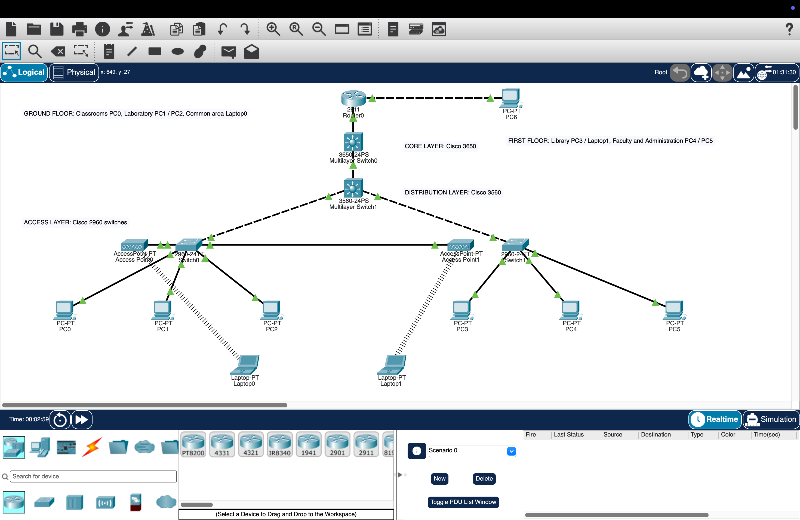

**Figure 2.** Saved optimized campus reopened in Packet Tracer; logical labels represent five functional zones.

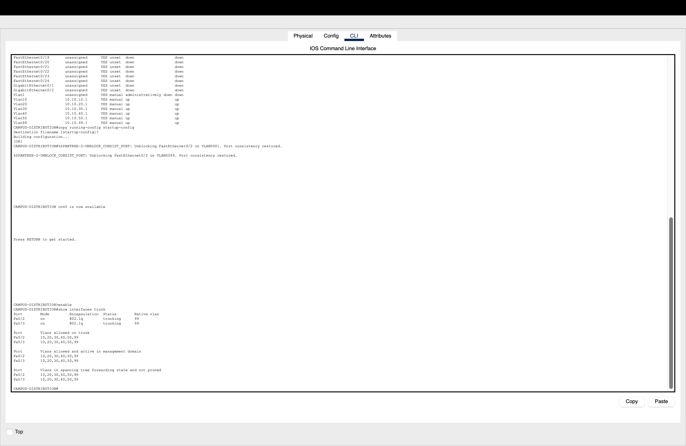

**Figure 3.** Distribution uplinks trunk all six VLANs, native VLAN 99; all six are forwarding.

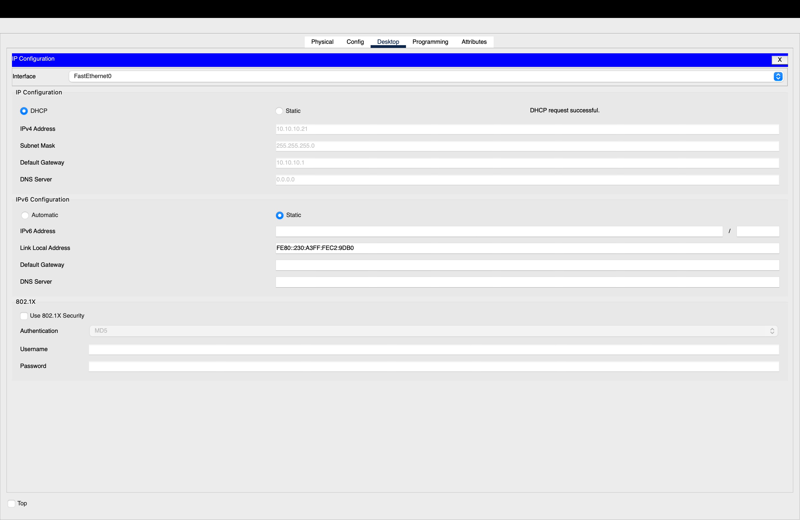

**Figure 4.** Student PC1 obtains 10.10.10.21/24 and gateway 10.10.10.1 after reopening.

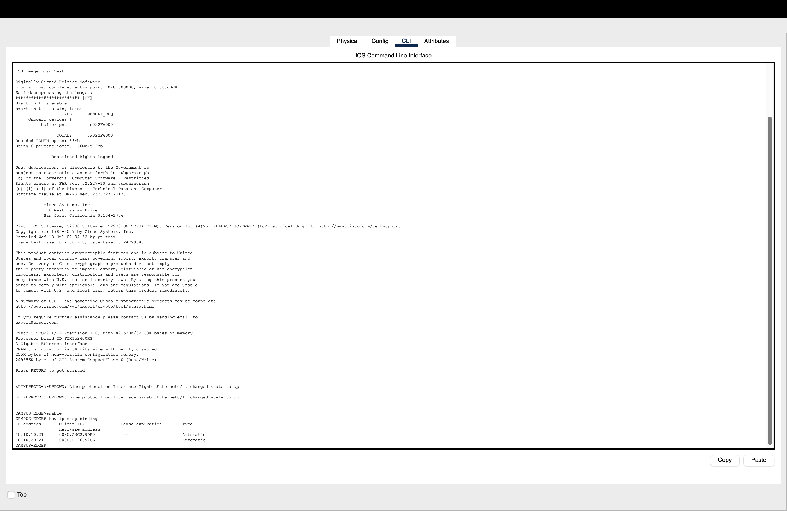

**Figure 5.** Edge router DHCP bindings corroborate the Student and Faculty leases.

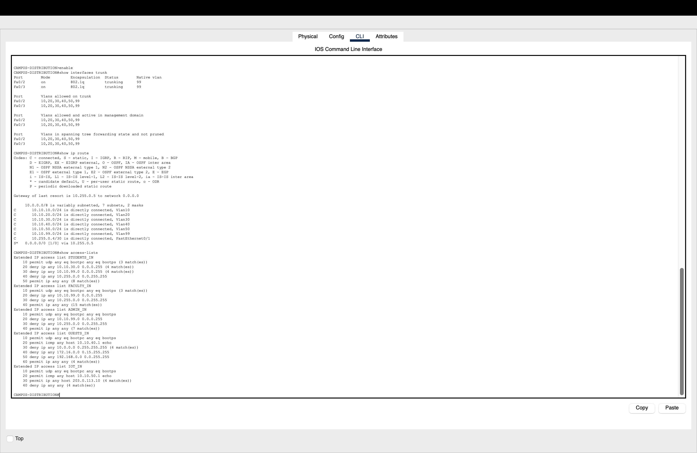

**Figure 6.** Distribution ACL readback and counters support observed policy outcomes.

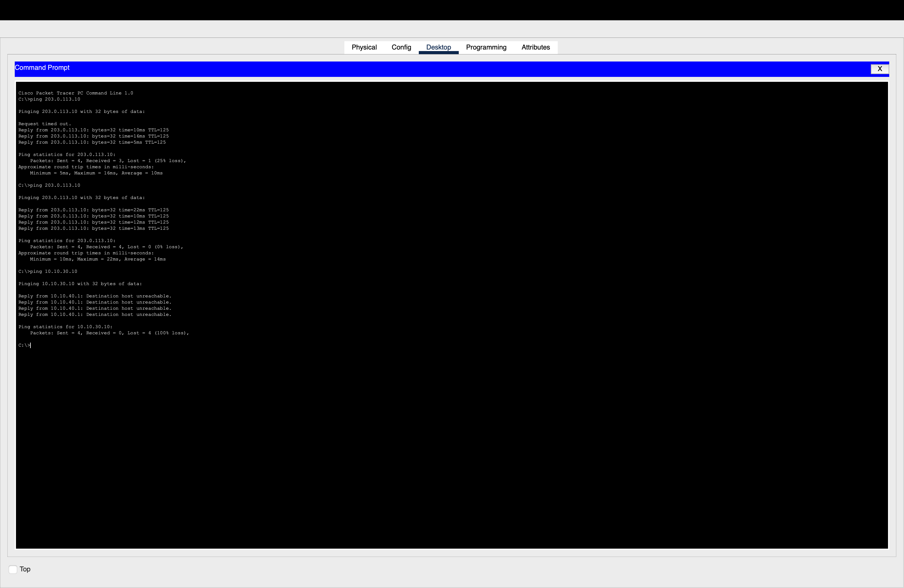

**Figure 7.** Guest wireless client receives zero echo replies from Administration; rejection is intended.

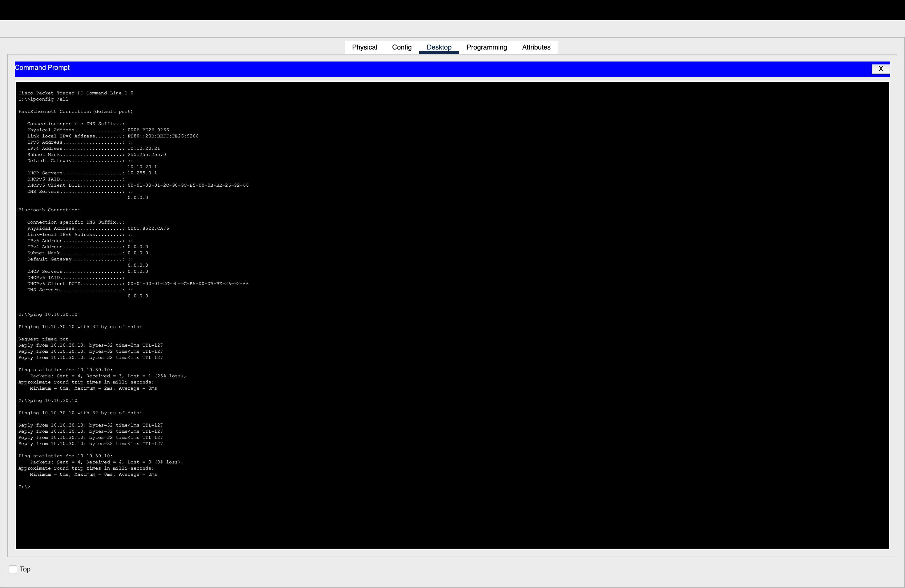

**Figure 8.** Faculty reaches Administration with four of four replies after initial ARP handling.

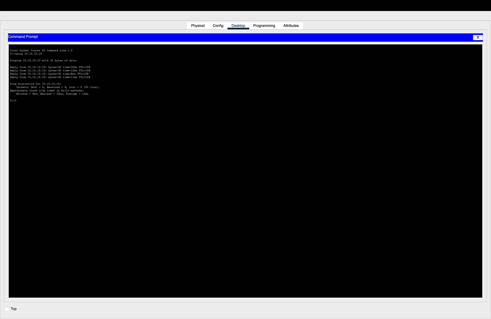

**Figure 9.** Standalone Student WLAN forwards to the wired Student endpoint after reopening.

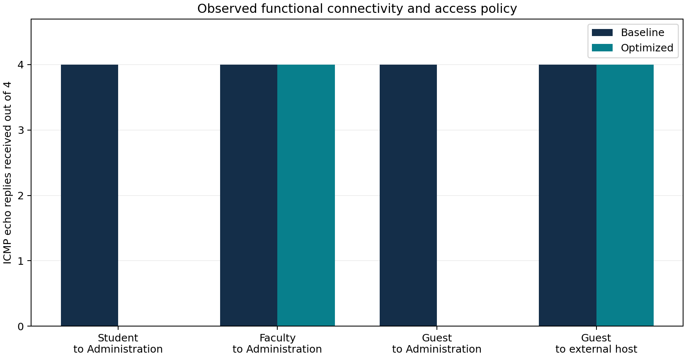

**Figure 10.** Observed four-packet probe reply counts. Zero on denied flows represents policy enforcement.

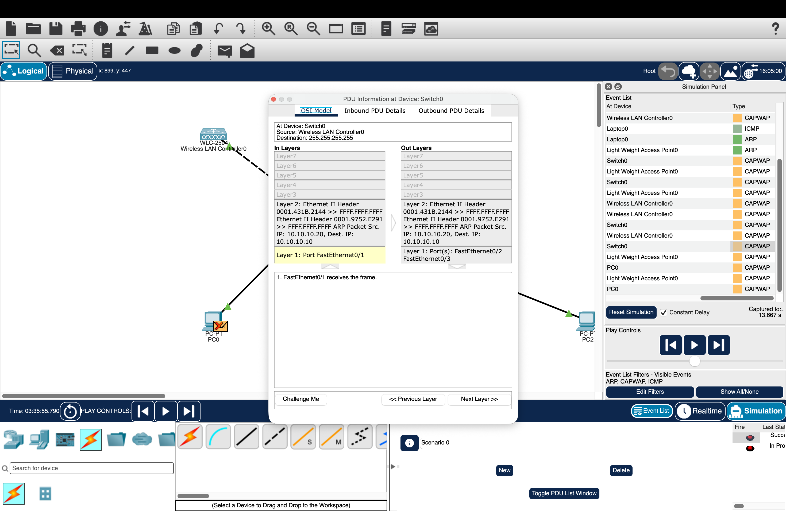

**Figure 11.** Preserved historical WLC diagnostic: VLAN 10 forwarding failure remains unresolved.

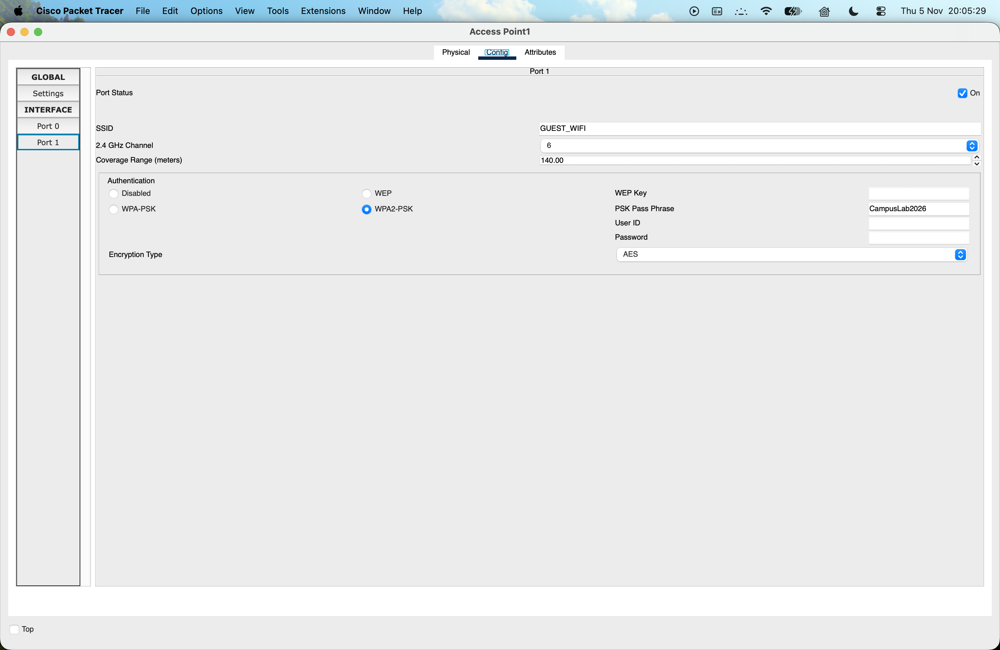

**Figure 12.** Guest standalone AP configuration: channel 6, WPA2-PSK/AES.

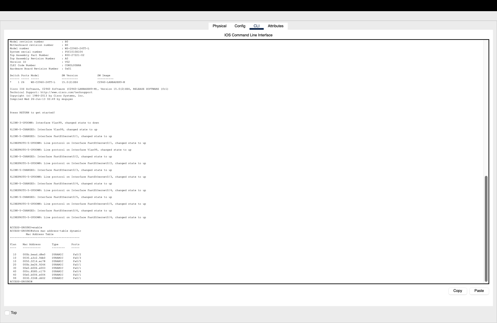

**Figure 13.** Fresh MAC learning after reopening: Student WLAN on Fa0/5 VLAN 10; Guest WLAN on Fa0/6 VLAN 40.

## Chapter 5 — Results and Discussion

### 5.1 Essential verification outcomes

| Requirement | Recorded observation | Outcome |
| --- | --- | --- |
| Within-VLAN switching | PC0 → DHCP Student PC1, 4/4 | PASS |
| 802.1Q propagation | Two distribution trunks; all six VLANs active and forwarding | PASS |
| Inter-VLAN routing | Student → Faculty and Faculty → Administration, 4/4 | PASS |
| DHCP allocation | PC1 and PC3 actual leases plus router bindings, retained after reopen | PASS for tested pools |
| Permitted / denied policies | Eight allowed and five denied optimized probes match their expectations | PASS for sampled flows |
| Standalone wireless data | Student WLAN → wired Student and Guest WLAN → external host, 4/4 | PASS |
| Management separation | Authorized PC5 → access/core succeeds; Student/external → management denied | PASS for sampled ICMP paths |
| Native-file persistence | Both .pkt files opened; five optimized follow-up probes match expected outcomes | PASS |
| Controller-based WLAN | Historical VLAN 10 repeated 0/4, VLAN 99 observation; unresolved | FAIL, preserved |

### 5.2 Complete optimized probe record

Each result is a four-packet completed trial. Eight permitted flows have 4/4 echo replies; five intended denied flows have 0/4. All thirteen therefore pass the specified functional/policy expectation. This is not a performance score.

| Test | Expectation | Echo replies | Result | Raw evidence |
| --- | --- | --- | --- | --- |
| Wired within VLAN | allow | 4/4 | PASS | [transcript](../submission-evidence/logs/optimized_within_vlan_first.txt) |
| Student to Faculty | allow | 4/4 | PASS | [transcript](../submission-evidence/logs/optimized_student_faculty_repeat.txt) |
| Faculty to Administration | allow | 4/4 | PASS | [transcript](../submission-evidence/logs/optimized_faculty_admin_repeat.txt) |
| Student to Administration | deny | 0/4 | PASS | [transcript](../submission-evidence/logs/optimized_student_admin_first.txt) |
| Guest to external host | allow | 4/4 | PASS | [transcript](../submission-evidence/logs/optimized_guest_external_first.txt) |
| Guest to Administration | deny | 0/4 | PASS | [transcript](../submission-evidence/logs/optimized_guest_admin_first.txt) |
| IoT proxy to external host | allow | 4/4 | PASS | [transcript](../submission-evidence/logs/optimized_iot_external_first.txt) |
| IoT proxy to Administration | deny | 0/4 | PASS | [transcript](../submission-evidence/logs/optimized_iot_admin_first.txt) |
| Management to access switch | allow | 4/4 | PASS | [transcript](../submission-evidence/logs/optimized_management_access_repeat.txt) |
| Management to core | allow | 4/4 | PASS | [transcript](../submission-evidence/logs/optimized_management_core_first.txt) |
| Student to management switch | deny | 0/4 | PASS | [transcript](../submission-evidence/logs/optimized_student_management_first.txt) |
| External host to management switch | deny | 0/4 | PASS | [transcript](../submission-evidence/logs/optimized_external_management_first.txt) |
| Wireless Student to wired Student | allow | 4/4 | PASS | [transcript](../submission-evidence/logs/optimized_wireless_student_first.txt) |

### 5.3 Comparable baseline and optimized flows

Nine identical role-to-role purposes were probed in both designs. Destination addresses change with the VLAN design, while endpoint identities and four-echo method remain comparable. Every baseline flow had 4/4 steady-state replies. The optimized design preserves legitimate connectivity and blocks the four sampled unauthorized campus paths below. The additional external-to-management denial is recorded only in the optimized set.

| Comparable flow | Baseline replies | Optimized replies | Optimized expectation |
| --- | --- | --- | --- |
| Wired within VLAN | 4/4 | 4/4 | allow |
| Student to Administration | 4/4 | 0/4 | deny |
| Faculty to Administration | 4/4 | 4/4 | allow |
| Guest to Administration | 4/4 | 0/4 | deny |
| Guest to external host | 4/4 | 4/4 | allow |
| IoT proxy to Administration | 4/4 | 0/4 | deny |
| Wireless Student to wired Student | 4/4 | 4/4 | allow |
| Student to management switch | 4/4 | 0/4 | deny |
| IoT proxy to external host | 4/4 | 4/4 | allow |

The [comparison CSV](../results/comparison.csv) records transcript provenance for both sides of every row. Figure 10 and presentation slide 11 chart four representative flows from these records. A zero-height optimized bar means the policy intentionally denied that probe.

### 5.4 Persistence and corroboration

After native reopen, Student and Faculty DHCP leases were renewed and read back. Five further optimized probes cover within-VLAN connectivity, Faculty-to-Administration permission, Guest-to-external permission, Guest-to-Administration denial and Student wireless forwarding. All matched their expected outcomes. Fresh Ground MAC learning shows VLAN 10 wireless traffic on Fa0/5 and VLAN 40 on Fa0/6. Distribution ACL counters record hits on tested permit and deny entries. The baseline was independently reopened and its wireless Student control again received 4/4. The machine-readable [persistence record](../submission-evidence/logs/persistence_results.json) and raw transcripts retain this evidence.

### 5.5 Interpretation and threats to validity

The defensible improvement is the introduction of enforceable role boundaries while sampled permitted paths continue to work. The baseline openly reaches Administration and management because it has no departmental isolation, not because it is malfunctioning. AP distribution and channel configuration are more deliberate in the optimized design, but the experiment did not measure radio contention, useful throughput or signal strength. The same small representative population cannot support claims about hundreds of users or congestion under load. Warm-up differences, ARP, simulation timing and repeated probes are documented rather than hidden.

Historical CSV files remain byte-for-byte archived and excluded from current conclusions. Values such as 50 to 180 Mbps and 78% to 95% coverage lack evidence and are not measured project outcomes. Current canonical CSV files contain verified functional records only.

## Chapter 6 — Conclusion and Future Scope

### 6.1 Conclusion

A functioning baseline and a six-VLAN optimized campus were created and saved in the actual Packet Tracer application. The implementation retains distinct core, distribution and access devices, DHCP relay across a routed core, access trunks, distribution-layer gateways and sampled role-policy enforcement. Basic standalone wireless forwarding works. The saved optimized file retains its behavior after reopening. The evidence supports a functional network segmentation demonstration and an explicit AP/channel planning strategy.

### 6.2 Limitations

The campus is hypothetical. No SRM floor dimensions, population counts, physical AP locations or surveyed coverage are asserted. The 16 devices, two APs and eight campus endpoints are simulation assumptions, not capacity recommendations. Canvas positions and floor labels are illustrative and do not establish floor attenuation, interference, signal strength or client density.

PC2 is a PC-PT proxy for IoT network policy; appliance registration and telemetry are untested. Six DHCP pools are configured, but actual lease allocation was verified only for Students and Faculty. Other representatives use static addresses. The external PC at 203.0.113.10 is a routed simulation endpoint, not live Internet access. DNS, NAT, HTTP application services, enterprise authentication, SSH administration, redundancy, roaming, WPA3 and QoS were not implemented or verified. Management tests establish IP reachability, not an authenticated management service.

The WLC-based historical fixture still fails wireless VLAN 10 forwarding and has an unresolved root cause. Current WLAN success concerns the two standalone AP-PT devices only. There is one SSID per AP and an untagged access uplink; multi-SSID-to-VLAN tagging is not demonstrated. No throughput, RF coverage percentage, latency improvement or congestion reduction has been established. Four-packet functional probes do not support statistical performance claims.

### 6.3 Future engineering work

Apply the final institutional report template when supplied, add the five team members' identities and rehearse a demonstration from the saved .pkt files. Further engineering can diagnose the separate WLC VLAN mismatch without rewriting its original outcome, validate all DHCP role pools, add management authentication and service-specific ACLs, and address return traffic with an explicit security model. A real deployment study would require floor plans, RF surveys, client-density/load assumptions and a suitable emulator or measured testbed for throughput, interference, roaming and resilience.

## Verified IEEE-style reference candidates

The following primary sources were checked for relevance. Access date: 5 November 2026. Exact institutional bibliography styling can be applied after the report template arrives. These are vendor/standards references, not invented journal papers.

[1] Cisco, “Campus LAN and Wireless LAN Solution Design Guide,” [Online]. Available: https://www.cisco.com/c/en/us/td/docs/solutions/CVD/Campus/cisco-campus-lan-wlan-design-guide.html. [Accessed: Nov. 5, 2026].

[2] Cisco, “Understand Site Survey Guidelines for WLAN Deployment,” [Online]. Available: https://www.cisco.com/c/en/us/support/docs/wireless/5500-series-wireless-controllers/116057-site-survey-guidelines-wlan-00.html. [Accessed: Nov. 5, 2026].

[3] Cisco, “RF Channels on a Cisco Business Wireless Network,” [Online]. Available: https://www.cisco.com/c/en/us/support/docs/smb/wireless/CB-Wireless-Mesh/2069-tz-Changing-RF-Channels.html. [Accessed: Nov. 5, 2026].

[4] R. Droms, “Dynamic Host Configuration Protocol,” RFC 2131, March 1997. [Online]. Available: https://www.rfc-editor.org/rfc/rfc2131. [Accessed: Nov. 5, 2026].

[5] Y. Rekhter et al., “Address Allocation for Private Internets,” RFC 1918, February 1996. [Online]. Available: https://www.rfc-editor.org/rfc/rfc1918. [Accessed: Nov. 5, 2026].

## Evidence package index

- [Baseline native topology](../packet-tracer/baseline/campus_baseline.pkt) and [optimized native topology](../packet-tracer/optimized/campus_optimized.pkt).
- [Presentation](../presentation/Campus_WLAN_Optimization_Final.pptx).
- [Baseline outcomes](../results/baseline.csv), [optimized outcomes](../results/optimized.csv), [comparison data](../results/comparison.csv), [graph](../results/functional-comparison.png).
- [Applied command sequences](../submission-evidence/configurations/), [raw readback and ping transcripts](../submission-evidence/logs/), [genuine captures](../submission-evidence/screenshots/).
- [Figure source/hash manifest](figure-manifest.json) and [execution capture manifest](../submission-evidence/logs/screenshot-manifest.json).
- [Preserved historical data](../results/historical/README.md), [original narrative documents](../submission-evidence/references/original-project-documents/).
- Original capability workspace remains outside this repository at ../PT-Capability-Lab. Its Task 7 reports document the historical wired PASS and WLC wireless FAIL.
